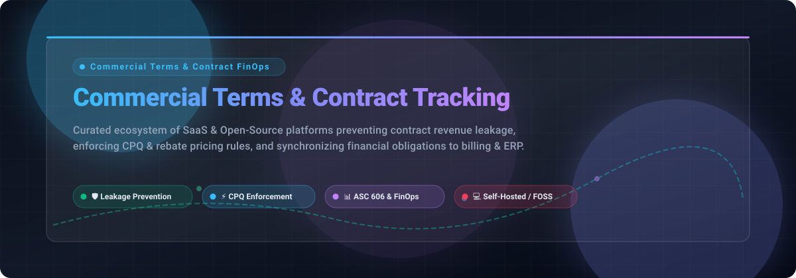

# Awesome Commercial Terms & Contract Financial Tracking 💼📊

<div align="center">



<br/>

<a href="https://github.com/ishandutta2007/Awesome-Awesome-Awesome"></a>
<a href="https://discord.gg/jc4xtF58Ve"></a>
<a href="https://github.com/ishandutta2007/Awesome-Commercial-Terms-Contract-Financial-Tracking/stargazers"></a>
<a href="https://github.com/ishandutta2007/Awesome-Commercial-Terms-Contract-Financial-Tracking/network/members"></a>
<a href="https://github.com/ishandutta2007/Awesome-Commercial-Terms-Contract-Financial-Tracking/issues"></a>
<a href="https://github.com/ishandutta2007/Awesome-Commercial-Terms-Contract-Financial-Tracking/blob/main/LICENSE"></a>
<a href="https://github.com/ishandutta2007"></a>

<p align="center">
  <strong>Curated ecosystem of SaaS platforms, enterprise CLM suites, and open-source GitHub tools for contract financial tracking, pricing enforcement, and revenue leakage prevention.</strong>
</p>

</div>

---

## 🌟 Overview & Highlights

Welcome to the definitive directory for **Commercial Terms & Contract Financial Tracking**! 🚀

In complex B2B enterprises, billions of dollars are routinely lost between contract execution and invoice payment. This repository tracks top **enterprise SaaS platforms** and **open-source (FOSS) projects** designed for finance, procurement, and legal operations teams. These tools enforce commercial terms—such as volume rebates, milestone payment caps, auto-renewals, penalties, and ASC 606 revenue recognition rules—bridging the gap directly into ERP and billing systems.

### 🎯 Key Focus Areas
- 🛡️ **Revenue Leakage Prevention:** Identifying unbilled entitlements, SLA failures, and untracked discounts.
- ⚡ **Configure-Price-Quote (CPQ) & Pricing Optimization:** Enforcing deal governance and deterministic rate cards.
- 📑 **Contract Lifecycle Management (CLM):** Automating pre-signature redlining and post-signature obligation monitoring.
- 💳 **Contract-to-Cash & Billing Orchestration:** Usage-based metering, milestone-based invoicing, and automated three-way matching.
- 🔓 **Self-Hosted Open-Source Architecture:** FOSS stacks for teams avoiding recurring six-figure enterprise contracts.

---

## 📑 Table of Contents
- [📈 Sector Overview & Market Dynamics](#-sector-overview--market-dynamics)
- [🏢 SaaS / Hosted Platforms](#-saas--hosted-platforms)
- [💻 Open-Source GitHub Projects](#-open-source-github-projects)
- [🏗️ Recommended Architecture Stack](#️-recommended-architecture-stack)
- [🤝 How to Contribute](#-how-to-contribute)
- [💖 Support](#-support)
- [📊 Star History](#-star-history)
- [⚖️ Disclaimer](#️-disclaimer)

---

## 📈 Sector Overview & Market Dynamics

The global Contract Lifecycle Management (CLM) and contract-to-cash financial tracking sector is estimated at approximately **$2.0 billion to $2.5 billion** and projected to reach **$4.6 billion to $7.1 billion by the early 2030s** (expanding at an 11–13% CAGR) 📊. 

This rapid expansion is fueled by organizations aggressively plugging post-signature contract revenue leakage—which independently averages between **8.6% and 9.2% of annual contract value** (WorldCC/Deloitte benchmarks) 💸. The vendor landscape remains **moderately fragmented**: mega-cap ERP incumbents (Oracle, SAP) and private equity consolidators (Thoma Bravo) dominate broad procurement deployments, while specialized best-of-breed enterprise CLM suites (Icertis, Tipalti, Zuora) and AI-native contract intelligence innovators compete vigorously for CFO and legal ops mindshare.

---

## 🏢 SaaS / Hosted Platforms

| Product | Company Size (Valuation / Revenue) | Description | Pricing (Starting Tier) | Free Tier / Trial Limits |
|:---|:---|:---|:---|:---|
| **[Oracle Financials Cloud](https://www.oracle.com/)** | **~$450B+ Market Cap** (~$53B+ Annual Revenue) | 🏛️ Enterprise financial suite providing general ledger integrity, automated payables matching, and contract accounting compliance. | Core Financials: **$375–$475/user/month** (list rate; negotiated volume discounts typical) | No free tier; custom 30-day guided evaluation sandbox available upon request via sales |
| **[Oracle NetSuite](https://www.netsuite.com/)** | **Part of Oracle** (~$450B+ Cap / ~$53B+ Rev) | ☁️ Leading cloud ERP featuring robust contract billing, procurement, multi-currency accounting, and revenue recognition. | Standard: **$999/month base platform** + **$99/user/month** | No free tier; product walkthroughs & custom sandbox demos available via sales |
| **[SAP Ariba](https://www.sap.com/)** | **~$270B+ Market Cap** (~$35B+ Annual Revenue) | 🌐 Global procurement and enterprise contract suite connecting spend directly to agreed contractual terms and automated matching. | Platform subscriptions start at **~$2,000/month** (~$25,000/year base; enterprise packages $80,000+/year) | Free tier available for suppliers (Standard Ariba Network Account); buyers must request custom demo |
| **[Coupa](https://www.coupa.com/)** | **$8.0B Valuation** (Acquired by Thoma Bravo; ~$800M+ Revenue) | 🛒 Enterprise spend management platform covering procurement, invoicing, expense tracking, and contract lifecycle management. | Core deployments start at **~$1,250/month** (~$15,000/year; mid-market deployments typically $50,000+/year) | 30-day free trial on Advanced Supplier portal; no free tier for core enterprise buyer platform |
| **[Tipalti](https://tipalti.com/)** | **$8.3B Valuation** (~$200M+ ARR) | 💸 Accounts payable automation and global payments platform featuring automated PO matching and contract compliance verification. | AP Select: **$99/month** (flat platform fee with unlimited users; transaction fees apply) | No free tier; sandbox evaluation and custom product demonstration available via sales |
| **[Icertis](https://www.icertis.com/)** | **~$3.0B–$5.0B Valuation** (~$350M+ ARR) | 🧠 AI-powered contract intelligence platform surfacing hidden entitlements, rebate milestones, and price adjustment caps. | Enterprise contracts start at **~$2,500/month** (~$30,000–$88,000/year base deployment) | No free tier; custom proof-of-concept / sandbox evaluation available via sales |
| **[Zuora RevPro (Zuora Revenue)](https://www.zuora.com/)** | **$1.7B Valuation** (Acquired by Silver Lake; ~$450M+ Revenue) | 📈 Enterprise revenue recognition automation and contract accounting engine built specifically for ASC 606 & IFRS 15 compliance. | Launch tier starts at **~$1,000/month** (~$12,000/year base via AWS Marketplace / direct quote) | No free tier; developer test tenant and custom proof-of-concept sandbox available via sales |
| **[PROS Smart CPQ](https://www.pros.com/)** | **$1.4B Valuation** (Acquired by Thoma Bravo; ~$350M+ Revenue) | 🎯 AI-driven configure-price-quote engine enforcing commercial pricing rules and contract rate agreements in complex B2B deals. | Essentials tier starts at **~$60/user/month** (minimum annual contract terms apply) | No free tier; demo and custom sandbox evaluation available via sales |
| **[Vendavo](https://www.vendavo.com/)** | **~$150M–$250M Revenue** (PE-backed by Francisco Partners & Accel-KKR) | 📊 Intelligent B2B CPQ, price optimization, and rebate contract governance platform preventing margin erosion. | Basic tier starts at **$65/user/month** (enterprise packages typically $75,000+/year) | 14-day free trial available for select modules; no permanent free tier |
| **[Pricefx](https://www.pricefx.com/)** | **~$90M+ Revenue** (Scale-up backed by Apax Digital) | 🏷️ Cloud pricing optimization, rebate analytics, and CPQ software for mid-market and enterprise manufacturers and distributors. | Core platform subscriptions start at **~$4,166/month** (~$50,000/year base; training courses from $450) | No free tier; demo and custom pilot evaluation available via sales |

---

## 💻 Open-Source GitHub Projects

| Project | Stars | Description |
|:---|:---:|:---|
| **[Documenso](https://github.com/documenso/documenso)** | [](https://github.com/documenso/documenso/stargazers) | ✍️ Open-source digital signing and agreement infrastructure platform. Provides digital contract signing workflows, tamper-evident audit trails, and automated signature tracking as an open alternative to DocuSign. |
| **[Lago](https://github.com/getlago/lago)** | [](https://github.com/getlago/lago/stargazers) | 🌊 Open-source metering and usage-based billing engine. Implements dynamic pricing rules, subscription terms, real-time consumption tracking, and automated invoice calculation against customer agreements. |
| **[Flexprice](https://github.com/flexprice/flexprice)** | [](https://github.com/flexprice/flexprice/stargazers) | ⚡ Open-source developer-first usage-based pricing and billing system. Enforces real-time entitlement limits, credit top-ups, tiered commercial pricing models, and multi-tenant billing pipelines. |
| **[Kill Bill](https://github.com/killbill/killbill)** | [](https://github.com/killbill/killbill/stargazers) | 💳 Open-source enterprise subscription billing and payment orchestration platform. Manages complex multi-currency recurring commercial agreements, overdue invoice dunning, and custom financial accounting integrations. |
| **[OpenMeter](https://github.com/openmeterio/openmeter)** | [](https://github.com/openmeterio/openmeter/stargazers) | ⏱️ Cloud-native real-time usage metering and billing infrastructure for APIs and AI models. Tracks high-volume consumption events and aligns them with contracted SLA rates and billing thresholds. |
| **[Open Mercato](https://github.com/open-mercato/open-mercato)** | [](https://github.com/open-mercato/open-mercato/stargazers) | 🛍️ Open-source commerce and CPQ platform with a deterministic rule evaluation engine for product configuration, BOM quantities, and quote-line snapshots for reproducible pricing. |
| **[OpenContracts](https://github.com/Open-Source-Legal/OpenContracts)** | [](https://github.com/Open-Source-Legal/OpenContracts/stargazers) | 📄 Open-source document intelligence and contract management platform. Extracts contractual terms, obligations, and clauses from enterprise legal agreements using deep learning and vector search. |
| **[MetaSign](https://github.com/ncc-erp/metasign)** | [](https://github.com/ncc-erp/metasign/stargazers) | 📝 Open-source electronic contract solution designed for enterprise agreement lifecycle tracking, signing workflow approvals, and operational contract management. |
| **[Accord Project](https://github.com/accordproject/cicero)** | [](https://github.com/accordproject/cicero/stargazers) | ⚖️ Open-source smart legal contract framework hosted under the Linux Foundation. Expresses commercial terms and legally enforceable agreement clauses as computable code. |
| **[OCA Contract](https://github.com/OCA/contract)** | [](https://github.com/OCA/contract/stargazers) | 📦 Odoo Community Association suite for recurring contract management, commercial terms tracking, invoicing alignment, and automated renewal date monitoring. |
| **[Shillinq](https://github.com/ConductionNL/shillinq)** | [](https://github.com/ConductionNL/shillinq/stargazers) | 🧩 Open-source business administration suite for Nextcloud combining bookkeeping, procurement, and contract lifecycle management with obligation tracking dashboards. |

---

## 🏗️ Recommended Architecture Stack

Engineering teams can assemble an end-to-end, vendor-neutral commercial terms tracking system using open-source building blocks:
```
┌─────────────────────────────────────────────────────────────┐
│ 1. Agreement & Signing Layer: Documenso / MetaSign         │
│    (Executes binding electronic signatures & audit trails)  │
└──────────────────────────────┬──────────────────────────────┘
                               │
┌──────────────────────────────▼──────────────────────────────┐
│ 2. Clause & Term Extraction: OpenContracts / Accord Project │
│    (Extracts pricing rules, milestones, caps & penalties)   │
└──────────────────────────────┬──────────────────────────────┘
                               │
┌──────────────────────────────▼──────────────────────────────┐
│ 3. CPQ & Deal Governance: Open Mercato                      │
│    (Configures quote snapshots & deterministic rate cards)  │
└──────────────────────────────┬──────────────────────────────┘
                               │
┌──────────────────────────────▼──────────────────────────────┐
│ 4. Consumption Metering & Invoicing: Lago / Flexprice       │
│    (Matches actual usage to contract rates & triggers ERP)  │
└─────────────────────────────────────────────────────────────┘
```

---

## 🤝 How to Contribute

Contributions make the open-source community an incredible place to learn, inspire, and create! 💡

1. 🍴 **Fork the Project**
2. 🌿 **Create your Feature Branch** (`git checkout -b feature/AddAwesomeTool`)
3. 📝 **Commit your Changes** (`git commit -m 'Add new commercial terms tracking tool'`)
4. 🚀 **Push to the Branch** (`git push origin feature/AddAwesomeTool`)
5. 📬 **Open a Pull Request**

*Please ensure newly submitted SaaS tools include starting pricing and trial terms, and open-source projects include star count badges.*

---

## 💖 Support

If you found this curated list helpful for your finance, legal ops, or engineering stack:
- ⭐ **Star this repository** to help others discover it!
- 🍴 **Fork and share** it with your colleagues and network.
- ☕ **Buy me a coffee / Sponsor**: Support ongoing maintenance and curation via the [GitHub Sponsor Dashboard](https://github.com/sponsors/ishandutta2007).

Your support is deeply appreciated! 🙏✨

---

## 📊 Star History

[](https://www.star-history.com/#ishandutta2007/Awesome-Commercial-Terms-Contract-Financial-Tracking&type=date&legend=top-left)

---

## ⚖️ Disclaimer

- This list is **community-curated** for educational and architectural evaluation purposes—it is not formal financial, tax, or legal advice.
- Commercial terms and financial tracking systems handle sensitive contractual agreements, pricing matrices, and bank payment pipelines; always implement least-privilege security controls, comprehensive audit logging, and ensure compliance with SOX, ASC 606, and IFRS 15 frameworks.
- Pricing, valuations, and trial details reflect current public marketplace information and may change over time; contact respective software vendors directly for verified quotes.

---

<div align="center">
  <sub>Built with ❤️ for finance engineers, procurement innovators, and contract-to-cash builders worldwide.</sub>
</div>
